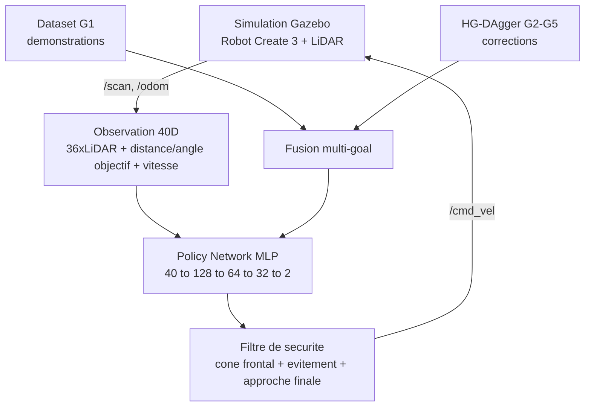

# Navigation Autonome par Imitation Learning : évaluation BC vs BC+HG-DAgger

[](https://docs.ros.org/en/humble/)
[](https://classic.gazebosim.org/)
[](https://pytorch.org/)
[](https://www.python.org/)

---

## Présentation du projet

Ce projet implémente un système de **navigation autonome multi-objectif** pour un robot **iRobot Create 3** par **apprentissage par imitation**, dans un environnement simulé sous **ROS 2** et **Gazebo**.

Le robot apprend à naviguer vers **5 objectifs** à partir de démonstrations (Behavioral Cloning, BC), puis la politique est affinée par des sessions interactives de **HG-DAgger** ciblées sur chaque nouvel objectif.


*Les 5 objectifs dans l'environnement en L : G1 (orange), G2 (vert), G3 (violet), G4 (bleu/robot), G5 (jaune, partiellement masqué).*

### Objectifs

1. Apprendre une politique de navigation à partir de démonstrations humaines.
2. Naviguer de manière autonome dans un couloir en L avec obstacles.
3. Généraliser à **5 objectifs différents**.
4. **Mesurer rigoureusement** l'apport de HG-DAgger par rapport au BC seul.

---

## Pipeline global



---

## Résultats : campagne d'évaluation v2 (but G1)

### Protocole

- **3 modèles entraînés par méthode** (seeds d'entraînement 0, 1, 2), **10 essais par modèle**, soit 30 essais par méthode.
- **Poses de départ identiques** pour les deux méthodes (essais appariés par `trial_seed`).
- Environnement isolé, filtre de sécurité et approche finale activés (`use_safety_filter=1`, `use_final_approach=1`, `max_bumps=3`).
- Données brutes : `results/experiments/trials_g1_v2.csv` (une ligne par essai).
- Les essais ont été lancés sur le commit `73fd5e3`, antérieur au commit « Evaluation v2 ».

### Résultats globaux

| Méthode | Réussites | Collisions | Timeouts | Taux | IC 95 % (Wilson) |
|---|---|---|---|---|---|
| BC | 17/30 | 13 | 0 | 56,7 % | 39 – 73 % |
| BC+HG-DAgger | 20/30 | 6 | 4 | 66,7 % | 49 – 81 % |

Test exact de Fisher bilatéral : **p = 0,596** (différence non significative à 5 %).
Essais appariés : 12 réussis par les deux, 5 échoués par les deux, 8 réussis seulement par BC+HG-DAgger, 5 seulement par BC (test de McNemar exact : p ≈ 0,58).

### Résultats par seed d'entraînement

| Seed | BC | BC+HG-DAgger |
|---|---|---|
| 0 | 8/10 (80 %) | 6/10 (60 %) |
| 1 | 9/10 (90 %) | 9/10 (90 %) |
| 2 | **0/10 (0 %)** | 5/10 (50 %) |

### Détails (moyenne ± écart-type)

| Mesure | BC | BC+HG-DAgger |
|---|---|---|
| Temps de navigation (succès) | 29,6 ± 2,4 s | 42,1 ± 22,8 s |
| Trajet (succès) | 10,2 ± 0,8 m | 13,2 ± 6,9 m |
| Distance finale au but | 2,37 ± 2,22 m | 1,86 ± 2,07 m |
| Déclenchements du filtre de sécurité | 26,3 ± 11,8 | 25,1 ± 19,9 |
| Contacts (pare-chocs) par essai | 1,97 ± 1,03 | 1,13 ± 1,20 |

Tous les essais qui atteignent la zone finale (distance réelle ≤ 1,5 m) réussissent : 17/17 pour BC et 20/20 pour BC+HG-DAgger.

### Interprétation

- L'écart global (+10 points) provient **uniquement du seed 2**. Sur les seeds 0 et 1, BC+HG-DAgger fait égal ou moins bien que BC.
- La variabilité entre seeds de BC (0 % à 90 %) est supérieure à l'écart entre les deux méthodes.
- BC+HG-DAgger remplace des collisions par des timeouts (collisions 13 → 6, timeouts 0 → 4) : comportement plus prudent, mais plus lent et plus variable.
- Les échecs viennent de la navigation, pas de l'approche finale.
- **Conclusion prudente** : sur G1, aucun effet de HG-DAgger n'est démontré. Une tendance vers moins de collisions et une meilleure régularité entre seeds est observée, mais elle reste à confirmer avec plus de seeds.

### Limites de cette campagne

- **3 modèles par méthode** : les 30 essais ne sont pas indépendants (ils sont groupés par modèle). Le test de Fisher et les intervalles de Wilson, calculés sur les essais, sont donc trop optimistes.
- Seul le but **G1** est évalué, c'est-à-dire le but sur lequel le BC a déjà été entraîné, où HG-DAgger a le moins à apporter.
- Le **seed 2 de BC (0 %)** n'est pas encore expliqué (défaut d'entraînement, mauvais checkpoint, ou vraie instabilité de la méthode).
- Les essais ont été lancés sur le commit `73fd5e3` ; les modifications de `eval_campaign_node.py` du commit v2 ne sont pas couvertes.

### Reproduire les statistiques

```bash
python3 scripts/stats_par_methode.py results/experiments/trials_g1_v2.csv
python3 scripts/stats_par_methode.py results/experiments/trials_g1_v2.csv --max-seed 20   # N essais par méthode
python3 scripts/taux_zone.py results/experiments/trials_g1_v2.csv
```

Le premier script écrit aussi `results/experiments/stats_par_methode.csv`.

---

## Étape préliminaire (première campagne)

Première évaluation, plus petite et sans analyse par seed, conservée dans `results/preliminary_stage/`.

### Taux de réussite par objectif


| Goal | Coordonnées | Pas DAgger | Essais | Taux de réussite |
|------|-------------|------------|--------|-------------------|
| G1   | (5.5, 1.5)  | — (dataset initial) | 10 | 70.0 % |
| G2   | (6.5, -2.0) | 176 | 6 | 50.0 % |
| G3   | (1.0, 2.0)  | 74  | 7 | 85.7 % |
| G4   | (6.0, 0.0)  | 197 | 6 | 66.7 % |
| G5   | (0.5, -2.0) | 54  | 7 | 100.0 % |
| **Moyenne** | — | — | **36** | **75.0 %** |

### Impact de HG-DAgger sur G2


| Modèle | Essais | Taux de réussite | Comportement observé |
|--------|--------|-------------------|-----------------------|
| BC seul (jamais vu G2) | 6 | 0 % | Timeout systématique, errance sans collision |
| BC + HG-DAgger | 6 | 50 % | Réussite dans la moitié des essais |

**Attention** : avec 6 essais par méthode, cet écart n'est pas significatif (test de Fisher, p ≈ 0,18). C'est une piste à confirmer, pas un résultat établi.

---

## Limites connues du système

- **Minima locaux** : le filtre de sécurité réactif peut osciller dans les passages étroits.
- **Détection frontale uniquement** : les collisions latérales en virage ne sont pas couvertes par le cône de sécurité actuel.
- **Déséquilibre du dataset** : les corrections sur G2 à G5 représentent 5,19 % (palier 5 %) puis 10,16 % (palier 10 %) du jeu
  d'entraînement ; seul G3 en profite nettement (voir la section « généralisation »).
- **Obstacle sur la ligne vers G5** : `cylinder_obstacle_1` (1,0 ; -1,2) provoque tous les échecs de la seed 2 sur G5 ; ni le
  filtre de sécurité ni les corrections collectées n'y changent rien.
- **Instabilité d'infrastructure (WSL2 + Gazebo Classic)** : une part des lancements automatisés échoue au spawn, indépendamment du modèle.

---

## Prochaines étapes

1. **Analyser le seed 2 de BC (0 %)** : courbe de perte, checkpoint, trajectoires (`scripts/voir_approche.py`, `scripts/carte_echecs.py`).
2. **Augmenter le nombre de seeds d'entraînement** (5 à 10 par méthode) et analyser au niveau des seeds plutôt que des essais.
3. ~~Évaluer G2 à G5 avec le même protocole~~ : fait pour les paliers 5 % et 10 % (30 essais par goal).
4. **Évaluer BC sur G2 à G5** (30 essais par goal) pour mesurer l'apport réel de HG-DAgger sur les nouveaux goals.
5. **Collecter des corrections autour du cylindre** `cylinder_obstacle_1` (palier à nommer à part) et séparer l'effet
   de la quantité de celui du ciblage des corrections.
6. Relancer les campagnes sur un même commit pour assurer la reproductibilité.

---

## Structure du projet

```text
ImitaNav-evaluation
  ros2_ws/src
    create3_il                    Package ROS2 (collecte, entrainement, noeud d'evaluation)
      create3_il/eval_campaign_node.py
    create3_lidar_description     Create 3 + LiDAR (URDF/SDF)
  config
  data
  maps
  media                           Figures et videos
  results
    experiments                   Campagne v2 : trials_g1_v2.csv, stats_par_methode.csv, trajectories/
    preliminary_stage             Premiere campagne
  scripts
    run_campaign.sh               Lancement d'une campagne d'evaluation
    make_plan_g1.py               Generation du plan d'essais
    stats_par_methode.py          Statistiques BC vs BC+HG-DAgger
    taux_zone.py                  Taux d'essais atteignant la zone finale
    carte_echecs.py               Carte des echecs
    diagnostic_approche_finale.py Diagnostic de l'approche finale
    voir_approche.py              Visualisation des trajectoires d'approche
  archive_ancien_pipeline
    data/dataset.npz              Dataset G1
    scripts                       build_dataset, check_and_clean_dataset, merge_dagger_data,
                                  train_bc, train_bc_multigoal, run_evaluation.sh,
                                  summarize_evaluation.py, test_sim_start.sh
  README.md
```

---

## Installation

**Prérequis** : Ubuntu 22.04, ROS 2 Humble, Gazebo Classic 11, Python 3.8+, PyTorch (CPU).

```bash
git clone https://github.com/qamarfrikha-a11y/ImitaNav-evaluation.git
cd ImitaNav-evaluation/ros2_ws
colcon build
source install/setup.bash
```

### Changer d'objectif dynamiquement (sans recompilation)

```bash
ros2 topic pub --once /goal_pose geometry_msgs/msg/PoseStamped \
  "{pose: {position: {x: 6.0, y: 0.0, z: 0.0}}}"
```

### Pipeline actuel

```bash
python3 scripts/build_training_sets.py                         # jeux d'entraînement + manifest
python3 scripts/train_bc_clean.py bc_dag_all_10pct --seed 0 1 2 # modèles -> models/clean/
N=30 TAG=dag10 ./scripts/run_goals.sh G1 G2 G3 G4 G5           # campagne d'essais
python3 scripts/make_results_tables.py                         # tableaux -> results/RESULTATS.md
python3 scripts/update_readme.py                               # met à jour la section résultats
```

Les corrections HG-DAgger se collectent avec `ros2 run create3_il dagger_session_node` (modèle de base choisi par la variable
`BC_MODEL_PATH`, goal publié sur `/goal_pose`).

### Entraînement (ancien pipeline)

```bash
python3 archive_ancien_pipeline/scripts/train_bc.py             # mono-goal (baseline)
python3 archive_ancien_pipeline/scripts/train_bc_multigoal.py   # multi-goal (G1 + DAgger)
```

### Lancer une campagne d'évaluation

```bash
./scripts/run_campaign.sh    # voir l'en-tête du script pour les arguments
```

<!-- RESULTS:START -->
## Résultats : généralisation aux goals G2 à G5 (paliers 5 % et 10 %)

Évaluation en simulation Gazebo (arène avec obstacles). Politique : MLP 40-128-64-32-2 entraîné par
clonage de comportement (BC), puis amélioré par HG-DAgger (corrections humaines pendant l'exécution).
30 essais par modèle et par goal (10 par seed d'entraînement 0, 1, 2), mêmes poses de départ pour tous
les modèles (essais appariés), filtre de sécurité actif. Les intervalles entre crochets sont des
intervalles de confiance à 95 % (Wilson) ; s0, s1, s2 désignent les seeds d'entraînement ; « p (signes) »
est un test des signes sur les essais appariés.

| Jeu d'entraînement | Pas BC | Corrections G1 | Corrections G2-G5 | Part G2-G5 |
|---|---|---|---|---|
| `bc` | 6004 | 0 | 0 | 0 % |
| `bc_dag_g1` | 6004 | 3151 | 0 | 0 % |
| `bc_dag_all` (« 5 % ») | 6004 | 3151 | 501 | 5,19 % |
| `bc_dag_all_10pct` (« 10 % ») | 6004 | 3151 | 1035 | 10,16 % |

Corrections G2-G5 par goal : G2 176 → 176, G3 74 → 364, G4 197 → 197, G5 54 → 298 (palier 5 % → 10 %).

### Ce qu'il faut retenir

- **Généralisation, G3** : le palier 10 % fait passer le succès de 6/30 (20 %) à 25/30 (83 %). Sur les essais
  appariés, 19 sont gagnés et aucun perdu, et le gain est présent pour les trois seeds (3→8, 0→7, 3→10). C'est le goal qui a reçu le plus de
  corrections (74 → 364 pas).
- **G2, G4, G5** : pas d'effet mesurable. **G1** : 80 % → 63 %, non significatif (p = 0,30).
- **La variance entre seeds est du même ordre que les effets** : par exemple sur G4, la seed 0 passe de 10/10 à
  3/10 et la seed 2 de 0/10 à 10/10, sans nouvelle collecte sur G4 entre les deux paliers.

### 1. G1 : BC contre BC + HG-DAgger (30 essais par methode, 3 seeds x 10)

Modeles presents dans le fichier : ['bc', 'bc_dag_g1']

| Methode | Succes [IC95 %] | Collisions | Timeouts | Seed 0 | Seed 1 | Seed 2 | Temps moyen des succes (s) |
|---|---|---|---|---|---|---|---|
| BC | 17/30 (57 %) [39-73] | 13 | 0 | 8/10 (80 %) | 9/10 (90 %) | 0/10 (0 %) | 29.6 |
| BC + HG-DAgger (G1) | 20/30 (67 %) [49-81] | 6 | 4 | 6/10 (60 %) | 9/10 (90 %) | 5/10 (50 %) | 42.1 |

Essais apparies (meme pose, meme seed) : BC seul reussit 5, HG-DAgger seul reussit 8 ; test des signes p = 0.581.

### 2. Generalisation : 5 % contre 10 % de corrections sur les autres goals

5 % = `bc_dag_all` (501 pas sur G2-G5, 5,19 %). 10 % = `bc_dag_all_10pct` (1035 pas sur G3 et G5, 10,16 %). Chaque case seed = succes sur 10 essais.

| Goal | 5 % s0 | 5 % s1 | 5 % s2 | **5 % total** [IC95 %] | 10 % s0 | 10 % s1 | 10 % s2 | **10 % total** [IC95 %] | Gagnes 5 % seul / 10 % seul | p (signes) |
|---|---|---|---|---|---|---|---|---|---|---|
| G1 | 9/10 | 10/10 | 5/10 | 24/30 (80 %) [63-90] | 7/10 | 6/10 | 6/10 | 19/30 (63 %) [46-78] | 10 / 5 | 0.302 |
| G2 | 9/10 | 4/10 | 6/10 | 19/30 (63 %) [46-78] | 9/10 | 0/10 | 7/10 | 16/30 (53 %) [36-70] | 6 / 3 | 0.508 |
| G3 | 3/10 | 0/10 | 3/10 | 6/30 (20 %) [10-37] | 8/10 | 7/10 | 10/10 | 25/30 (83 %) [66-93] | 0 / 19 | 0.000 |
| G4 | 10/10 | 5/10 | 0/10 | 15/30 (50 %) [33-67] | 3/10 | 2/10 | 10/10 | 15/30 (50 %) [33-67] | 11 / 11 | 1.000 |
| G5 | 10/10 | 3/10 | 0/10 | 13/30 (43 %) [27-61] | 10/10 | 1/10 | 0/10 | 11/30 (37 %) [22-54] | 3 / 1 | 0.625 |
| G2-G5 | 32/40 | 12/40 | 9/40 | 53/120 (44 %) [36-53] | 30/40 | 10/40 | 27/40 | 67/120 (56 %) [47-64] | 20 / 34 | 0.076 |
| G1-G5 | 41/50 | 22/50 | 14/50 | 77/150 (51 %) [43-59] | 37/50 | 16/50 | 33/50 | 86/150 (57 %) [49-65] | 30 / 39 | 0.336 |

### 3. Issues des essais (succes / collision / timeout)

| Goal | 5 % | 10 % |
|---|---|---|
| G1 | 24 / 6 / 0 | 19 / 9 / 2 |
| G2 | 19 / 10 / 1 | 16 / 13 / 1 |
| G3 | 6 / 22 / 2 | 25 / 2 / 3 |
| G4 | 15 / 15 / 0 | 15 / 15 / 0 |
| G5 | 13 / 9 / 8 | 11 / 10 / 9 |

### Analyse des échecs sur G5

Les échecs ont été localisés à partir des positions finales (trajectoires enregistrées) :

- **Seed 2** : les 10 échecs, aux deux paliers, finissent contre `cylinder_obstacle_1` (1,0 ; -1,2), placé
  sur la ligne vers le goal. Sans filtre de sécurité le robot le heurte (essai diagnostic) ; avec le filtre il reste
  bloqué (plus de 1000 déclenchements du filtre par essai). La seed 0 contourne l'obstacle par la gauche (10/10).
- **Seed 1** : les 7 collisions au cylindre du palier 5 % disparaissent au palier 10 %, mais 7 autres échecs apparaissent
  ailleurs dans l'arène (4 vers x ≈ 4,3 ; y ≈ 1,7-2,2 et 3 à l'est, x ≥ 5,8) : le problème se déplace.
- Le taux de succès global de G5 (43 % → 37 %) masque donc un changement de mode d'échec.

### Limites de la campagne de généralisation

- **Peu d'essais et peu de modèles** : 30 essais par cellule (IC95 % d'environ ±17 points) mais seulement
  3 modèles par palier. Les essais d'un même modèle ne sont pas indépendants : les p-valeurs du tableau (test des signes
  sur les essais) sont donc indicatives et trop optimistes. Seul l'effet sur G3, visible pour les trois seeds, résiste à ce bruit.
- **Trois seeds, un entraînement par seed** : la variance d'entraînement est du même ordre que les effets mesurés
  (le protocole est reproductible : le modèle 5 % seed 0 a été réentraîné à l'identique).
- **Quantité et répartition confondues** : le palier 5 % est réparti sur G2-G5, le palier 10 % est ciblé sur G3 et G5.
- **Un seul tour de HG-DAgger par palier** : les corrections ont été collectées sur le modèle 5 % puis ajoutées en une fois.
- **Collecte du palier 10 %** : deux sessions G5 très courtes (29 et 23 pas), conditions de simulation légèrement
  différentes (dock présent lors des premières sessions) et modèle de la première session G3 non confirmé.
- **Validation** : l'ensemble de validation passe de 1570 à 1599 pas entre les deux paliers.
- **Versions du code** : G1 testé au commit 73fd5e3, palier 5 % au commit 0b1ca12, palier 10 % au commit 228a398.
- **Étiquetage des goals de collecte** : le goal des sessions G1 est déduit (non enregistré dans les `.npy`),
  vérifié par les journaux ROS pour une session ; les nouvelles sessions l'enregistrent dans un JSON.
- **Pas de BC sur G2-G5 à 30 essais** : l'apport du HG-DAgger par rapport à BC sur les nouveaux goals n'est pas
  évalué dans cette campagne (la première campagne, 6 essais, n'est pas comparable).
- **4 essais redémarrés** après échec de démarrage de la simulation (G4 t05, G5 t05, t18, t25).

### Reproduire la campagne de généralisation

```bash
python3 scripts/build_training_sets.py
python3 scripts/train_bc_clean.py bc_dag_all_10pct --seed 0 1 2
N=30 TAG=dag10 ./scripts/run_goals.sh G1 G2 G3 G4 G5
python3 scripts/make_results_tables.py
python3 scripts/update_readme.py
```
<!-- RESULTS:END -->
