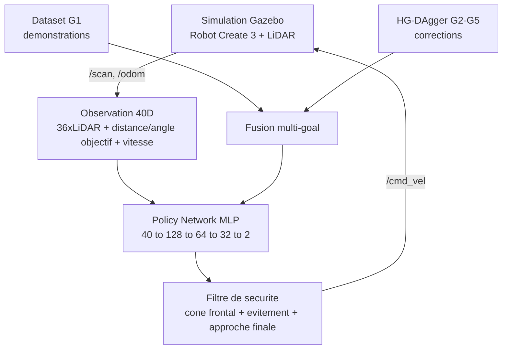

# Navigation Autonome par Imitation Learning : évaluation BC vs BC+HG-DAgger

[](https://docs.ros.org/en/humble/)
[](https://classic.gazebosim.org/)
[](https://pytorch.org/)
[](https://www.python.org/)

---

## Présentation du projet

Ce projet implémente un système de **navigation autonome multi-objectif** pour un robot **iRobot Create 3** par **apprentissage par imitation**, dans un environnement simulé sous **ROS 2** et **Gazebo**.

Le robot apprend à naviguer vers **5 objectifs** à partir de démonstrations (Behavioral Cloning, BC), puis la politique est affinée par des sessions interactives de **HG-DAgger** ciblées sur chaque nouvel objectif.


*Les 5 objectifs dans l'environnement en L : G1 (orange), G2 (vert), G3 (violet), G4 (bleu/robot), G5 (jaune, partiellement masqué).*

### Objectifs

1. Apprendre une politique de navigation à partir de démonstrations humaines.
2. Naviguer de manière autonome dans un couloir en L avec obstacles.
3. Généraliser à **5 objectifs différents**.
4. **Mesurer rigoureusement** l'apport de HG-DAgger par rapport au BC seul.

---

## Pipeline global



---

## Résultats : campagne d'évaluation v2 (but G1)

### Protocole

- **3 modèles entraînés par méthode** (seeds d'entraînement 0, 1, 2), **10 essais par modèle**, soit 30 essais par méthode.
- **Poses de départ identiques** pour les deux méthodes (essais appariés par `trial_seed`).
- Environnement isolé, filtre de sécurité et approche finale activés (`use_safety_filter=1`, `use_final_approach=1`, `max_bumps=3`).
- Données brutes : `results/experiments/trials_g1_v2.csv` (une ligne par essai).
- Les essais ont été lancés sur le commit `73fd5e3`, antérieur au commit « Evaluation v2 ».

### Résultats globaux

| Méthode | Réussites | Collisions | Timeouts | Taux | IC 95 % (Wilson) |
|---|---|---|---|---|---|
| BC | 17/30 | 13 | 0 | 56,7 % | 39 – 73 % |
| BC+HG-DAgger | 20/30 | 6 | 4 | 66,7 % | 49 – 81 % |

Test exact de Fisher bilatéral : **p = 0,596** (différence non significative à 5 %).
Essais appariés : 12 réussis par les deux, 5 échoués par les deux, 8 réussis seulement par BC+HG-DAgger, 5 seulement par BC (test de McNemar exact : p ≈ 0,58).

### Résultats par seed d'entraînement

| Seed | BC | BC+HG-DAgger |
|---|---|---|
| 0 | 8/10 (80 %) | 6/10 (60 %) |
| 1 | 9/10 (90 %) | 9/10 (90 %) |
| 2 | **0/10 (0 %)** | 5/10 (50 %) |

### Détails (moyenne ± écart-type)

| Mesure | BC | BC+HG-DAgger |
|---|---|---|
| Temps de navigation (succès) | 29,6 ± 2,4 s | 42,1 ± 22,8 s |
| Trajet (succès) | 10,2 ± 0,8 m | 13,2 ± 6,9 m |
| Distance finale au but | 2,37 ± 2,22 m | 1,86 ± 2,07 m |
| Déclenchements du filtre de sécurité | 26,3 ± 11,8 | 25,1 ± 19,9 |
| Contacts (pare-chocs) par essai | 1,97 ± 1,03 | 1,13 ± 1,20 |

Tous les essais qui atteignent la zone finale (distance réelle ≤ 1,5 m) réussissent : 17/17 pour BC et 20/20 pour BC+HG-DAgger.

### Interprétation

- L'écart global (+10 points) provient **uniquement du seed 2**. Sur les seeds 0 et 1, BC+HG-DAgger fait égal ou moins bien que BC.
- La variabilité entre seeds de BC (0 % à 90 %) est supérieure à l'écart entre les deux méthodes.
- BC+HG-DAgger remplace des collisions par des timeouts (collisions 13 → 6, timeouts 0 → 4) : comportement plus prudent, mais plus lent et plus variable.
- Les échecs viennent de la navigation, pas de l'approche finale.
- **Conclusion prudente** : sur G1, aucun effet de HG-DAgger n'est démontré. Une tendance vers moins de collisions et une meilleure régularité entre seeds est observée, mais elle reste à confirmer avec plus de seeds.

### Limites de cette campagne

- **3 modèles par méthode** : les 30 essais ne sont pas indépendants (ils sont groupés par modèle). Le test de Fisher et les intervalles de Wilson, calculés sur les essais, sont donc trop optimistes.
- Seul le but **G1** est évalué, c'est-à-dire le but sur lequel le BC a déjà été entraîné, où HG-DAgger a le moins à apporter.
- Le **seed 2 de BC (0 %)** n'est pas encore expliqué (défaut d'entraînement, mauvais checkpoint, ou vraie instabilité de la méthode).
- Les essais ont été lancés sur le commit `73fd5e3` ; les modifications de `eval_campaign_node.py` du commit v2 ne sont pas couvertes.

### Reproduire les statistiques

```bash
python3 scripts/stats_par_methode.py results/experiments/trials_g1_v2.csv
python3 scripts/stats_par_methode.py results/experiments/trials_g1_v2.csv --max-seed 20   # N essais par méthode
python3 scripts/taux_zone.py results/experiments/trials_g1_v2.csv
```

Le premier script écrit aussi `results/experiments/stats_par_methode.csv`.

---

## Étape préliminaire (première campagne)

Première évaluation, plus petite et sans analyse par seed, conservée dans `results/preliminary_stage/`.

### Taux de réussite par objectif


| Goal | Coordonnées | Pas DAgger | Essais | Taux de réussite |
|------|-------------|------------|--------|-------------------|
| G1   | (5.5, 1.5)  | — (dataset initial) | 10 | 70.0 % |
| G2   | (6.5, -2.0) | 176 | 6 | 50.0 % |
| G3   | (1.0, 2.0)  | 74  | 7 | 85.7 % |
| G4   | (6.0, 0.0)  | 197 | 6 | 66.7 % |
| G5   | (0.5, -2.0) | 54  | 7 | 100.0 % |
| **Moyenne** | — | — | **36** | **75.0 %** |

### Impact de HG-DAgger sur G2


| Modèle | Essais | Taux de réussite | Comportement observé |
|--------|--------|-------------------|-----------------------|
| BC seul (jamais vu G2) | 6 | 0 % | Timeout systématique, errance sans collision |
| BC + HG-DAgger | 6 | 50 % | Réussite dans la moitié des essais |

**Attention** : avec 6 essais par méthode, cet écart n'est pas significatif (test de Fisher, p ≈ 0,18). C'est une piste à confirmer, pas un résultat établi.

---

## Limites connues du système

- **Minima locaux** : le filtre de sécurité réactif peut osciller dans les passages étroits.
- **Détection frontale uniquement** : les collisions latérales en virage ne sont pas couvertes par le cône de sécurité actuel.
- **Déséquilibre du dataset** : G2 à G5 ne représentent qu'environ 3 % du volume total face à G1 (sur-échantillonnage identifié, non testé).
- **Instabilité d'infrastructure (WSL2 + Gazebo Classic)** : une part des lancements automatisés échoue au spawn, indépendamment du modèle.

---

## Prochaines étapes

1. **Analyser le seed 2 de BC (0 %)** : courbe de perte, checkpoint, trajectoires (`scripts/voir_approche.py`, `scripts/carte_echecs.py`).
2. **Augmenter le nombre de seeds d'entraînement** (5 à 10 par méthode) et analyser au niveau des seeds plutôt que des essais.
3. **Évaluer G2 à G5** avec le même protocole, car c'est là que HG-DAgger doit apporter le plus.
4. **Étudier l'effet de la quantité de corrections** (colonne `pct_correction`) sur la réussite.
5. Relancer une campagne sur le commit v2 pour assurer la reproductibilité.

---

## Structure du projet

```text
ImitaNav-evaluation
  ros2_ws/src
    create3_il                    Package ROS2 (collecte, entrainement, noeud d'evaluation)
      create3_il/eval_campaign_node.py
    create3_lidar_description     Create 3 + LiDAR (URDF/SDF)
  config
  data
  maps
  media                           Figures et videos
  results
    experiments                   Campagne v2 : trials_g1_v2.csv, stats_par_methode.csv, trajectories/
    preliminary_stage             Premiere campagne
  scripts
    run_campaign.sh               Lancement d'une campagne d'evaluation
    make_plan_g1.py               Generation du plan d'essais
    stats_par_methode.py          Statistiques BC vs BC+HG-DAgger
    taux_zone.py                  Taux d'essais atteignant la zone finale
    carte_echecs.py               Carte des echecs
    diagnostic_approche_finale.py Diagnostic de l'approche finale
    voir_approche.py              Visualisation des trajectoires d'approche
  archive_ancien_pipeline
    data/dataset.npz              Dataset G1
    scripts                       build_dataset, check_and_clean_dataset, merge_dagger_data,
                                  train_bc, train_bc_multigoal, run_evaluation.sh,
                                  summarize_evaluation.py, test_sim_start.sh
  README.md
```

---

## Installation

**Prérequis** : Ubuntu 22.04, ROS 2 Humble, Gazebo Classic 11, Python 3.8+, PyTorch (CPU).

```bash
git clone https://github.com/qamarfrikha-a11y/ImitaNav-evaluation.git
cd ImitaNav-evaluation/ros2_ws
colcon build
source install/setup.bash
```

### Changer d'objectif dynamiquement (sans recompilation)

```bash
ros2 topic pub --once /goal_pose geometry_msgs/msg/PoseStamped \
  "{pose: {position: {x: 6.0, y: 0.0, z: 0.0}}}"
```

### Entraînement (ancien pipeline)

```bash
python3 archive_ancien_pipeline/scripts/train_bc.py             # mono-goal (baseline)
python3 archive_ancien_pipeline/scripts/train_bc_multigoal.py   # multi-goal (G1 + DAgger)
```

### Lancer une campagne d'évaluation

```bash
./scripts/run_campaign.sh    # voir l'en-tête du script pour les arguments
```